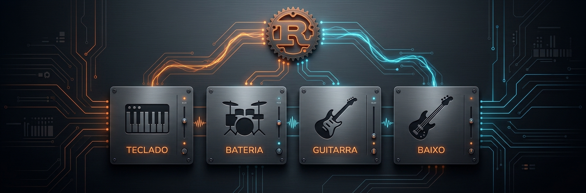

<div align="center">
  
</div>

# 🎹 Sintetizador e Sequenciador Modular em Rust


Um motor de áudio e sequenciador por passos (*step sequencer*) construído do zero em **Rust**, desenvolvido com o objetivo de aprender os fundamentos da síntese sonora digital, polifonia e gerenciamento de fluxo de áudio de baixo nível.

---

## 🚀 O que já foi implementado

O projeto está em desenvolvimento ativo, contando atualmente com as seguintes bases arquiteturais e sonoras:

* **Arquitetura Modular:** Separação limpa entre a lógica de reprodução principal (`main.rs`) e o módulo de criação de timbres (`instrumentos.rs`).
* **Polifonia Multi-Trilha (`Rodio`):** Uso de instâncias independentes de `Sink` (`Sink` paralelos) para permitir que múltiplos instrumentos e notas soem simultaneamente sem travar a esteira de áudio.
* **Síntese Tonal (Teclado/Synth):** Geração de ondas senoidais (`SineWave`) para frequências musicais precisas (ex: acordes).
* **Síntese de Percussão (Bateria/Caixa):** Geração de ruído branco estático utilizando a biblioteca `rand`, combinado com um **envelope de decaimento de amplitude** linear para dar corpo e som percussivo.
* **Lógica de Sequenciador por Passos:** Grade rítmica baseada em arrays lógicos (`true`/`false`) para disparar eventos rítmicos em compassos controlados.

---

## 🛠️ Tecnologias Utilizadas

* **[Rust](https://www.rust-lang.org/)** - Linguagem de programação focada em performance e segurança de memória.
* **[Rodio](https://crates.io/crates/rodio)** (v0.19) - Biblioteca de reprodução de áudio em Rust.
* **[Rand](https://crates.io/crates/rand)** - Biblioteca para geração de números pseudo-aleatórios (essencial para o ruído da bateria).

---

## 📂 Estrutura do Projeto

```text
rust-synth-sequencer/
├── Cargo.toml
└── src/
    ├── main.rs          # Gerencia o fluxo principal e o loop do sequenciador
    └── instrumentos.rs  # Fábrica de timbres (teclado, bateria e efeitos)
